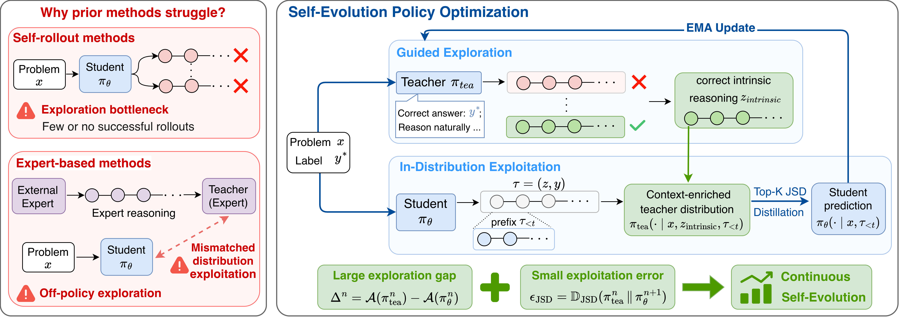

<div align="center">
  <h1>
    Self-Evolution Reasoner: Continuous Optimization via Policy-Intrinsic Exploration and Exploitation
    <br><br>
    <b>NIPS 2026</b>
    <br><br>
    <a href="https://arxiv.org/abs/ARXIV_ID" target="_blank">
      
    </a>
  </h1>
</div>


## Introduction

Unlike existing self-improvement methods that struggle with exploration bottlenecks or rely on off-policy expert demonstrations, our Self-Evolution Policy Optimization (SEPO) enables continuous reasoning improvement through guided exploration and in-distribution exploitation. SEPO uses ground-truth labels to elicit correct reasoning from the model itself, overcoming exploration barriers, and then internalizes the discovered reasoning through on-policy self-distillation. By iteratively expanding the model's exploration capabilities and effectively exploiting its own reasoning, SEPO achieves sustained self-evolution, superior training efficiency, and higher performance ceilings, even on challenging tasks and with smaller models.

<p align="center">

</p>


## Datasets

All datasets are included under `datasets/` as pre-processed `train.parquet` / `test.parquet` files:

```
datasets/
├── sciknoweval/
│   ├── biology/      # 450  train samples
│   ├── chemistry/    # 1890 train samples
│   ├── material/     # 841  train samples
│   └── physics/      # 720  train samples
├── synlogic/
│   └── per_task/
│       ├── arrow_maze/     # 990 train samples
│       └── dyck_language/  # 990 train samples
└── tooluse/          # 4046 train samples
```

Covering three task families: multiple-choice science QA (`sciknoweval`), symbolic reasoning (`synlogic`), and tool-use (`tooluse`).

---

## Training Scripts

Three scripts are provided under `experiments/sepo/chemistry/` (Qwen3-8B):

| Script | Method | Key hyper-parameters |
|---|---|---|
| `grpo_offpolicy.sh` | GRPO (off-policy) | `lr=1e-6`, `mini_batch=8`, `n=8` |
| `grpo_onpolicy.sh`  | GRPO (on-policy)  | `lr=1e-5`, `mini_batch=32`, `n=8` |
| `sepo_n8_b32_fb4.sh` | **SEPO** (ours)  | `lr=1e-5`, `mini_batch=32`, `n=8`, `n_conditional_fallback=4` |

Before running, open each script and set `MODEL_PATH` to your local model directory. No other path configuration is required — the launch scripts automatically resolve the repository root and export it as `REPO_ROOT`, which is then consumed by `verl/trainer/config/user.yaml`.

Launch (from anywhere):

```bash
bash experiments/sepo/chemistry/sepo_n8_b32_fb4.sh
bash experiments/sepo/chemistry/grpo_onpolicy.sh
bash experiments/sepo/chemistry/grpo_offpolicy.sh
```

To run SEPO/GRPO on other tasks (biology, material, physics, arrow_maze, dyck_language, tooluse), copy a script and change `DATA_PATH` to the corresponding directory under `datasets/`.

### Installation

**1. Install PyTorch:**

*   **For Ampere/Hopper (RTX 30/40, H100):**
    ```bash
    pip install torch==2.5.1 torchvision torchaudio --index-url https://download.pytorch.org/whl/cu124
    ```

*   **For Blackwell (RTX 50, RTX PRO 2000 Blackwell):**
    ```bash
    pip install torch==2.7.0 torchvision torchaudio --index-url https://download.pytorch.org/whl/cu128
    ```

**2. Install SEPO and Dependencies:**

```bash
# Install core dependencies (pinned versions)
pip install -r requirements.txt

# Install SEPO (verl) in editable mode
pip install -e .

# Install Flash Attention 2 (compiled from source)
pip install flash-attn --no-build-isolation
```

**3. Optional: Install SGLang/vLLM for high-throughput inference:**

```bash
pip install -r requirements_sglang.txt
```

#### Requirement Files

| File | Description |
|------|-------------|
| `requirements.txt`        | Core dependencies with pinned versions |
| `requirements-gh200.txt`  | For NGC vLLM container (excludes pre-installed packages) |
| `requirements-full.txt`   | Complete pip freeze from working environment |
| `requirements_sglang.txt` | SGLang/vLLM stack for local inference |
| `requirements-cuda.txt`   | Flash Attention (for non-Docker installs) |

## Citations
If you find this work useful, please kindly star the repo and and cite the paper below. For questions, contact wenhangshi@ruc.edu.cn, or open an issue. Thank you!

```bibtex
@misc{shi2026sepo,
  title={Self-Evolution Reasoner: Continuous Optimization via Policy-Intrinsic Exploration and Exploitation},
  author={Wenhang Shi and Yiren Chen and Zhe Zhao and Jinhao Dong and Wei Lu and Xiaoyong Du},
  year={2026},
  eprint={2610.34137},
  archivePrefix={arXiv},
  primaryClass={cs.LG},
  url={https://arxiv.org/abs/2610.34137}
}
```

## Acknowledgments

Our code implementation is built on top of [verl](https://github.com/verl-project/verl) and [SDPO](https://github.com/lasgroup/SDPO). We thank the authors for their excellent open-source contributions.
